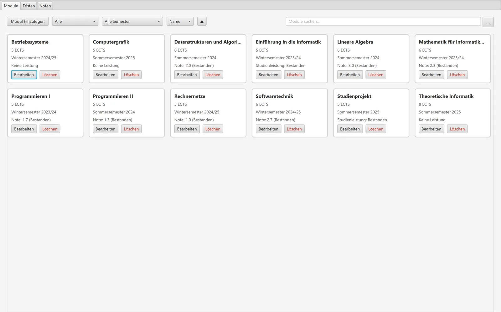
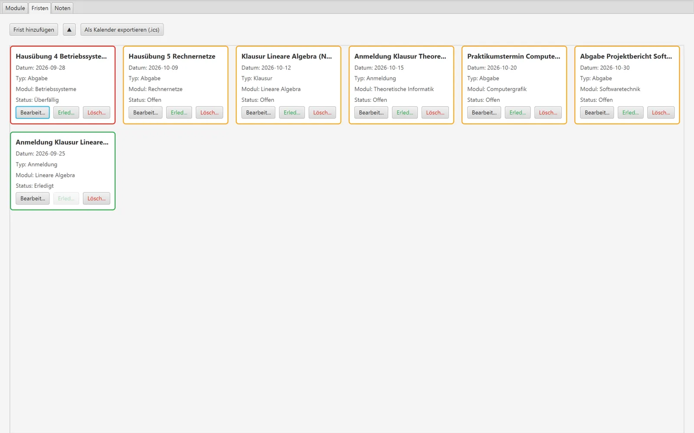
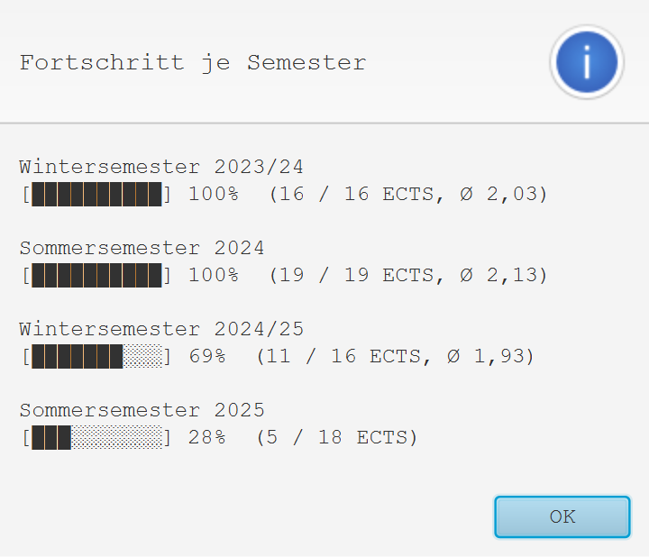

# Studentischer Organisationshelfer

[](https://github.com/daniilperkin-uni/oop_student_organizer/actions/workflows/ci.yml)

Ein Hilfswerkzeug für den studentischen Alltag, entwickelt in Java. 
Dieses Programm hilft Studierenden dabei, Fristen besser zu organisieren, Module zu verwalten und den eigenen Leistungsstand (Noten und ECTS) stets im Blick zu behalten. 

Entwickelt unter Anwendung aller gelernten Konzepte der objektorientierten Programmierung (OOP).

## Live-Showcase

Dieses Projekt hat eine Sektion auf der Uni-Projekte-Showcase-Seite: **[Live im Browser ansehen](https://daniilperkin-uni.github.io/uni-old-projects/#oop_student_organizer)** – mit Screenshots der laufenden App (Module, Fristen, Noten) und einem interaktiven Notensimulator, dessen ECTS-gewichtete Berechnung 1:1 aus dem `LeistungsRechner` dieses Repos portiert ist.

## Screenshots

Aufgenommen aus der laufenden App (Demo-Semester, keine echten Nutzerdaten):

| Module | Fristen | Semester-Dashboard |
| --- | --- | --- |
|  |  |  |

## Team und mein Beitrag

Das Projekt ist eine **Gruppenarbeit von sieben Personen** im Modul *Einführung in die Informatik*. Die Struktur des Projekts, die erste Deadline-Logik und Teile der Datenhaltung stammen von Teammitgliedern; der Stand auf `main` ist das Ergebnis aller Beiträge.

Meine Beiträge (rund zwei Drittel der Commits auf `main`; exakt nachzählen mit `git shortlog -sn HEAD`):

* **Domänenmodell:** `Modul`, `Semester`, `Leistung` mit `Pruefungsleistung`/`Studienleistung`, `ModulVerwaltung`, `LeistungsRechner`
* **Persistenz:** `SpeicherManager` – escape-fähiges CSV-Format, `.bak`-Sicherung, Formatkompatibilität zu den Altdaten
* **GUI-Verdrahtung:** `HomeController` und die Aufteilung in `ModuleTabController`, `DeadlineTabController`, `GradesTabController`
* **Features:** Notensimulator, ECTS-Fortschrittsdiagramm, Semester-Dashboard, ICS-Kalenderexport
* **Technik:** JavaFX-21-Migration, Maven-/JUnit-Modernisierung, CI-Workflow, Ausbau der Tests für Persistenz und Manager, README und `AGENTS.md`


## Kernfunktionen (Die 5 Pfeiler)

* **Verwaltung von Modulen:** Fächer inkl. ECTS und Semester anlegen, bearbeiten und verwalten – mit Suche, Filtern (Status, Semester) und Sortierung (Name, ECTS, Note).
* **Deadline-Tracking:** Anmelde- und Abgabefristen sowie Klausurtermine überwachen; jede Fristenkarte zeigt ihren Status (Offen / Überfällig / Erledigt) farblich an.
* **Leistungsüberwachung:** Automatischer, nach ECTS gewichteter Notendurchschnitt, ECTS-Fortschrittsdiagramm, Noten-Balkendiagramm je Modul, Semester-Dashboard mit Kennzahlen pro Semester und ein Notensimulator (Projektion des Endschnitts sowie „Welche Note brauche ich noch?“).
* **Persistente Datenhaltung:** Sicheres Speichern und Laden der Nutzerdaten auf der Festplatte.
* **Grafische Benutzeroberfläche (GUI):** Intuitive Bedienung durch eine moderne und übersichtliche Oberfläche.

## Technologien & Architektur

* **Sprache:** Java (JDK 21+)
* **GUI-Framework:** JavaFX (via FXML)
* **Build-Tool:** Maven
* **Architektur:** Model-View-Controller (MVC) zur sauberen Trennung von Daten, Logik und Oberfläche; `HomeController` koordiniert das Hauptfenster und delegiert je Tab an einen eigenen Controller.

## Voraussetzungen

* **JDK 21 oder neuer** (Entwicklung und CI: Temurin 21)
* Maven muss nicht installiert sein – der Maven Wrapper (`.mvn/wrapper/`, `mvnw`, `mvnw.cmd`) ist im Projekt enthalten.

## Starten des Programms

```bash
.\mvnw.cmd clean javafx:run   # Windows
./mvnw clean javafx:run       # macOS / Linux
```

> Hinweis: Die Anwendung wird ausschließlich über das `javafx:run`-Ziel gestartet. Das gebaute Jar enthält bewusst keinen `Main-Class`-Eintrag und ist nicht per `java -jar` startbar.

## Projektstruktur

* `src/main/java/com/example/einf/` – Domänen- und UI-Klassen
  * `Main.java` – Einstiegspunkt: lädt die Daten und verdrahtet Controller und Manager
  * `HomeController.java` – Koordinator des Hauptfensters, delegiert an `ModuleTabController`, `DeadlineTabController` und `GradesTabController`
  * Domänenklassen: `Modul`, `Semester`, `Leistung` (→ `Pruefungsleistung` / `Studienleistung`), `Deadline`, `DeadlineManager`, `ModulVerwaltung`, `LeistungsRechner`, `SemesterStatistik`, `EctsFortschritt`
  * Infrastruktur: `SpeicherManager` (CSV-Persistenz), `IcsExporter` (Kalenderexport), `EingabeValidierung`, `UiDialogs`
* `src/main/resources/com/example/einf/views/home-view.fxml` – FXML-Layout des Hauptfensters
* `src/main/resources/com/example/einf/styles/app.css` – Stylesheet
* `src/test/java/com/example/einf/` – 97 JUnit-Tests in 14 Testklassen

## OOP-Konzepte im Code

* **Kapselung:** Die Verwaltungsklassen (`ModulVerwaltung`, `DeadlineManager`, `SpeicherManager`) arbeiten mit defensiven Kopien und geben nur unveränderliche Sichten ihrer Listen heraus – Änderungen laufen ausschließlich über ihre Methoden.
* **Vererbung & Polymorphismus:** `Leistung` ist abstrakt; `Pruefungsleistung` (Note) und `Studienleistung` (bestanden ja/nein) implementieren `isBestanden()` und `getErreichteNote()` unterschiedlich. Auswertung und Anzeige nutzen diese gemeinsamen Methoden.
* **Trennung von Logik und Oberfläche (MVC):** Die Berechnungsklassen (`LeistungsRechner`, `SemesterStatistik`, `EctsFortschritt`) sind bewusst JavaFX-frei und dadurch direkt unit-testbar.
* **Robuste Datenformate:** Der `SpeicherManager` implementiert ein eigenes, escape-fähiges CSV-Format inkl. `.bak`-Sicherung; der `IcsExporter` erzeugt RFC-5545-konforme Kalenderdateien (CRLF-Zeilenenden, Escaping, Zeilenfaltung bei 75 Oktetten, Ganztagestermine).

## Datenhaltung

Alle Daten liegen im Verzeichnis `~/.studenthelfer` (unter Windows `%USERPROFILE%\.studenthelfer`):

* `module.csv` – Module inkl. ECTS, Semester und Leistung
* `deadlines.csv` – Fristen

Vor jedem Speichern wird die vorherige Version als `module.csv.bak` bzw. `deadlines.csv.bak` gesichert. Schlägt Laden oder Speichern fehl, zeigt die Anwendung einen Fehlerdialog.

## Kalender-Export (ICS)

Im Tab „Fristen“ exportiert „Als Kalender exportieren (.ics)“ alle Fristen als Ganztagestermine in die Datei `fristen.ics` im gewählten Ordner. Die Datei lässt sich in Outlook, Google Kalender oder Apple Kalender importieren.

## Tests

```bash
./mvnw -B verify   # 97 JUnit-Tests + JaCoCo-Report und Coverage-Schwelle (42 % Zeilen) unter target/site/jacoco
```
